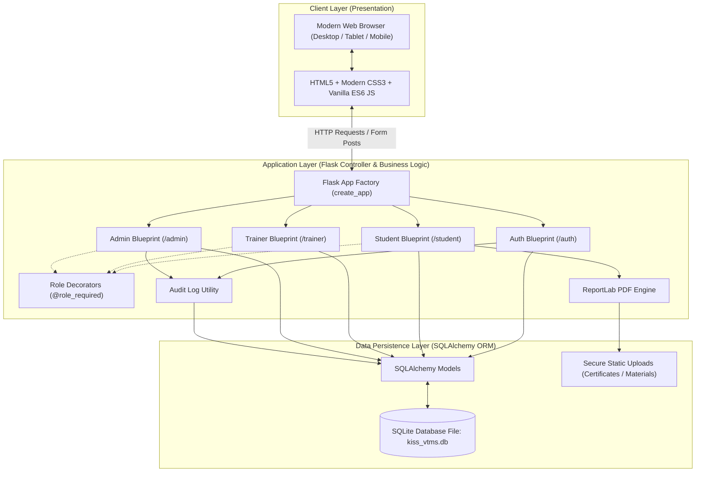
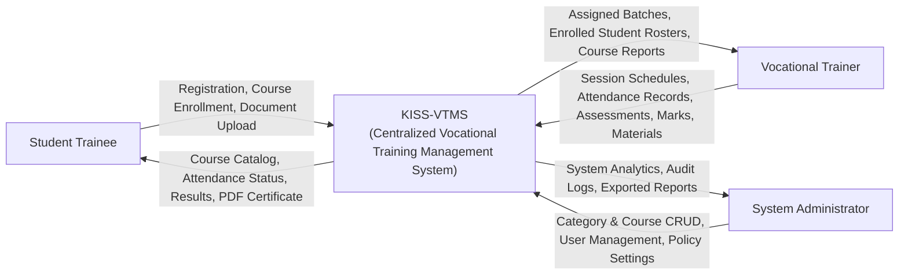
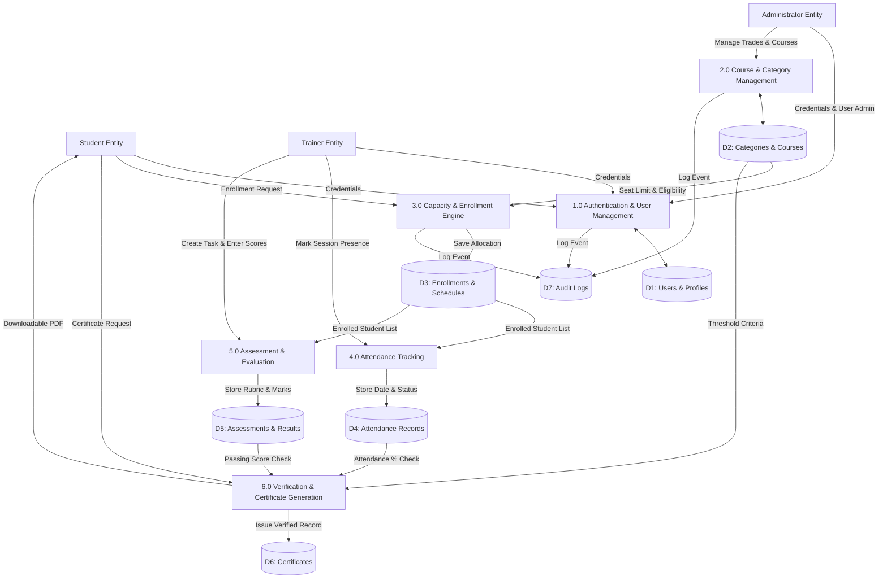
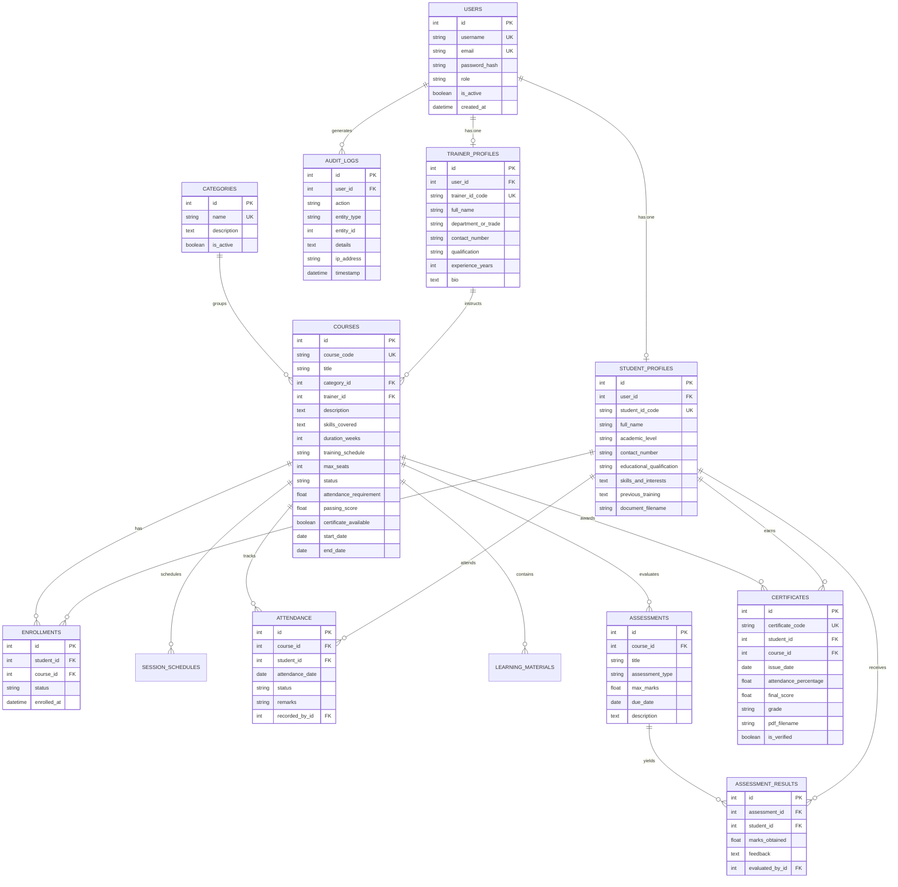
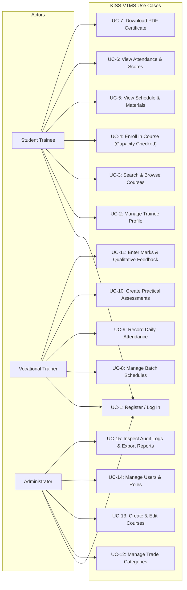
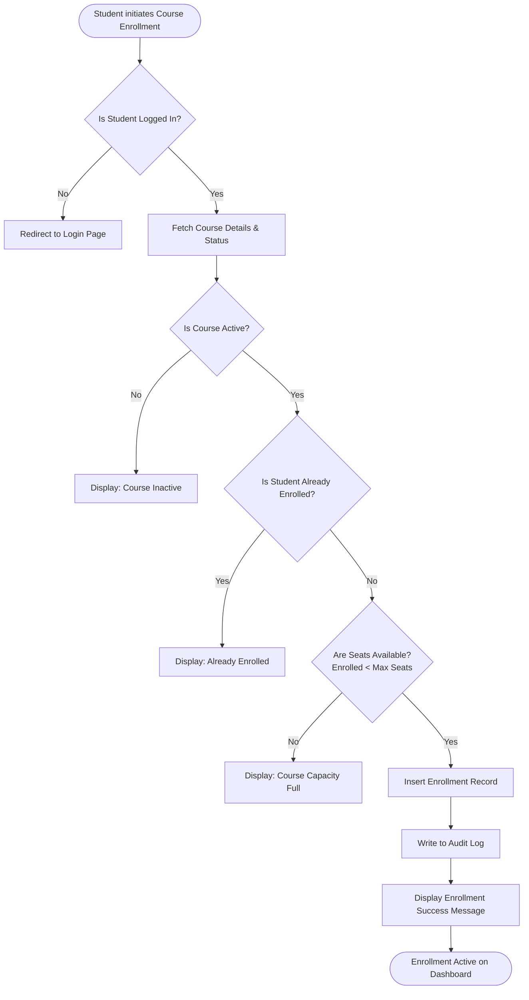
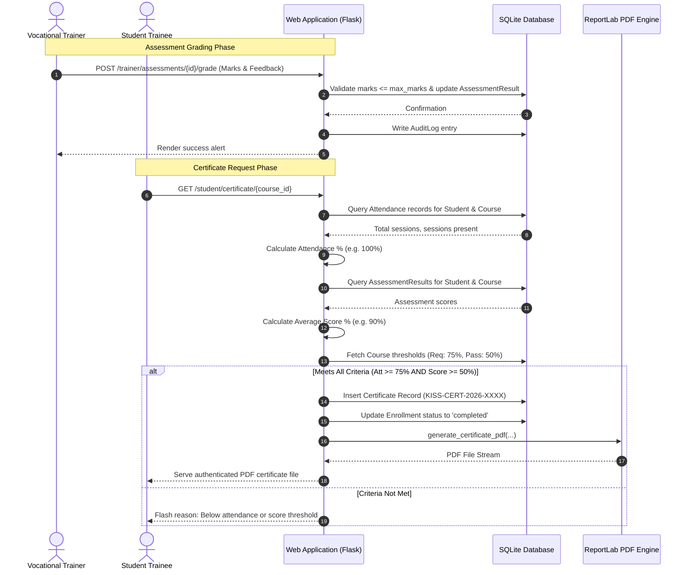

# System Architecture & Technical Design Document
## KISS Vocational Training Management System (VTMS)

---

### 1. System Architecture

The application adopts an MVC (Model-View-Controller) multi-layered architecture implemented via Flask Blueprints, Jinja2 template rendering, and SQLAlchemy ORM.

---

### 2. Data Flow Diagrams (DFD)

#### 2.1 Context Diagram (Level-0 DFD)
The context diagram models the system boundary, external entities (Student, Trainer, Administrator), and major input/output data flows.

#### 2.2 Level-1 Data Flow Diagram
The Level-1 DFD decomposes the system into its primary operational processes and persistent data stores.

---

### 3. Entity-Relationship (ER) Diagram

The normalized database schema ensures referential integrity, cascading updates, and data consistency.

---

### 4. UML Use Case Diagram

---

### 5. UML Activity Diagram: Course Enrollment

---

### 6. UML Sequence Diagram: Assessment Evaluation & Certificate Issuance

---

### 7. Database Data Dictionary

| Table Name | Column Name | Data Type | Nullable | Constraints & Key | Description |
| :--- | :--- | :--- | :---: | :--- | :--- |
| **users** | `id` | INTEGER | No | PK, Auto-increment | Internal unique user ID |
| | `username` | VARCHAR(64) | No | Unique, Index | Unique username |
| | `email` | VARCHAR(120) | No | Unique, Index | User contact email |
| | `password_hash` | VARCHAR(256) | No | | Werkzeug salted hash |
| | `role` | VARCHAR(20) | No | Check ('student','trainer','admin') | User access role |
| | `is_active` | BOOLEAN | No | Default: TRUE | Account operational status |
| | `created_at` | DATETIME | No | Default: UTC Now | Account creation timestamp |
| **student_profiles**| `id` | INTEGER | No | PK, Auto-increment | Profile ID |
| | `user_id` | INTEGER | No | FK(users.id), Unique | 1:1 link to User |
| | `student_id_code`| VARCHAR(30) | No | Unique, Index | Formatted KISS Trainee ID |
| | `full_name` | VARCHAR(100) | No | | Trainee full legal name |
| | `academic_level` | VARCHAR(50) | Yes | | Class/stream (+2 Arts/Sci, etc.) |
| | `contact_number` | VARCHAR(20) | Yes | | Phone contact |
| | `educational_qualification` | VARCHAR(100) | Yes | | Previous qualification |
| | `skills_and_interests` | TEXT | Yes | | Free text trade interests |
| **trainer_profiles**| `id` | INTEGER | No | PK, Auto-increment | Profile ID |
| | `user_id` | INTEGER | No | FK(users.id), Unique | 1:1 link to User |
| | `trainer_id_code`| VARCHAR(30) | No | Unique, Index | Formatted Trainer ID |
| | `full_name` | VARCHAR(100) | No | | Faculty name |
| | `department_or_trade` | VARCHAR(100) | Yes | | Trade domain |
| | `experience_years`| INTEGER | No | Default: 0 | Years of teaching experience |
| **categories** | `id` | INTEGER | No | PK, Auto-increment | Category ID |
| | `name` | VARCHAR(100) | No | Unique | Trade title (e.g. IT, Agriculture) |
| | `is_active` | BOOLEAN | No | Default: TRUE | Public visibility toggle |
| **courses** | `id` | INTEGER | No | PK, Auto-increment | Course ID |
| | `course_code` | VARCHAR(30) | No | Unique, Index | Unique course code (e.g. VT-IT-101) |
| | `title` | VARCHAR(150) | No | | Full course title |
| | `category_id` | INTEGER | No | FK(categories.id) | Linked category |
| | `trainer_id` | INTEGER | Yes | FK(trainer_profiles.id) | Assigned instructor |
| | `max_seats` | INTEGER | No | Default: 30 | Seat capacity limit |
| | `attendance_requirement` | FLOAT | No | Default: 75.0 | Minimum attendance % required |
| | `passing_score` | FLOAT | No | Default: 50.0 | Minimum passing score % |
| **enrollments** | `id` | INTEGER | No | PK, Auto-increment | Enrollment ID |
| | `student_id` | INTEGER | No | FK(student_profiles.id) | Student trainee |
| | `course_id` | INTEGER | No | FK(courses.id) | Enrolled course |
| | `status` | VARCHAR(20) | No | Default: 'enrolled' | 'enrolled', 'completed', 'cancelled' |
| | *Composite Unique* | | No | Unique(student_id, course_id) | Prevents duplicate enrollments |
| **attendance** | `id` | INTEGER | No | PK, Auto-increment | Attendance record ID |
| | `course_id` | INTEGER | No | FK(courses.id) | Training batch |
| | `student_id` | INTEGER | No | FK(student_profiles.id) | Trainee |
| | `attendance_date`| DATE | No | | Session date |
| | `status` | VARCHAR(20) | No | Default: 'present' | 'present', 'late', 'absent', 'excused' |
| | *Composite Unique* | | No | Unique(course_id, student_id, date) | Prevents duplicate logging |
| **assessments** | `id` | INTEGER | No | PK, Auto-increment | Assessment ID |
| | `course_id` | INTEGER | No | FK(courses.id) | Linked course |
| | `title` | VARCHAR(150) | No | | Assessment title |
| | `max_marks` | FLOAT | No | Default: 100.0 | Maximum achievable score |
| **assessment_results** | `id` | INTEGER | No | PK, Auto-increment | Result ID |
| | `assessment_id` | INTEGER | No | FK(assessments.id) | Linked assessment |
| | `student_id` | INTEGER | No | FK(student_profiles.id) | Evaluated trainee |
| | `marks_obtained`| FLOAT | No | | Points awarded |
| | `feedback` | TEXT | Yes | | Trainer coaching feedback |
| **certificates** | `id` | INTEGER | No | PK, Auto-increment | Certificate ID |
| | `certificate_code` | VARCHAR(50) | No | Unique, Index | Validation code |
| | `student_id` | INTEGER | No | FK(student_profiles.id) | Trainee recipient |
| | `course_id` | INTEGER | No | FK(courses.id) | Completed course |
| | `grade` | VARCHAR(10) | No | | Earned grade ('A+', 'A', etc.) |
| | `pdf_filename` | VARCHAR(255) | Yes | | Generated filename |
| **audit_logs** | `id` | INTEGER | No | PK, Auto-increment | Log record ID |
| | `user_id` | INTEGER | Yes | FK(users.id) | Initiating user |
| | `action` | VARCHAR(100) | No | | Action type |
| | `details` | TEXT | Yes | | Audit metadata |
| | `ip_address` | VARCHAR(45) | Yes | | Client IP address |
| | `timestamp` | DATETIME | No | Default: UTC Now | Timestamp |
